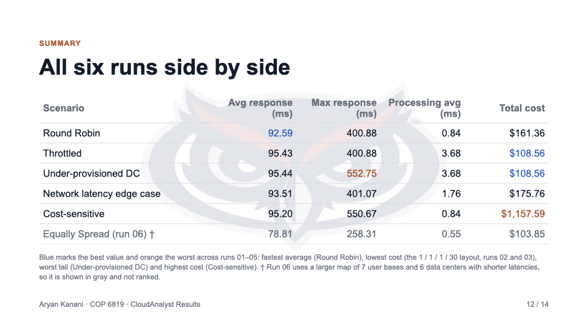
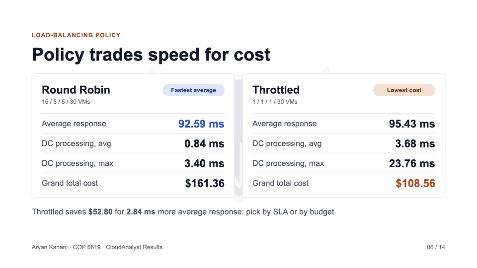
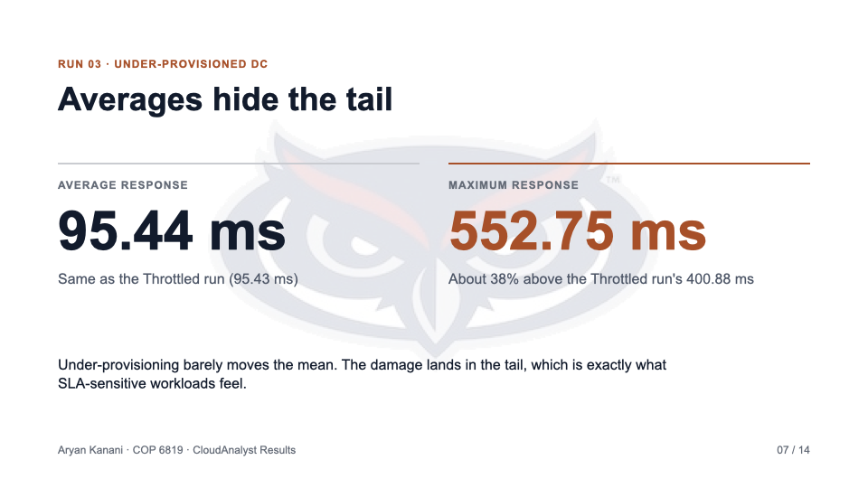
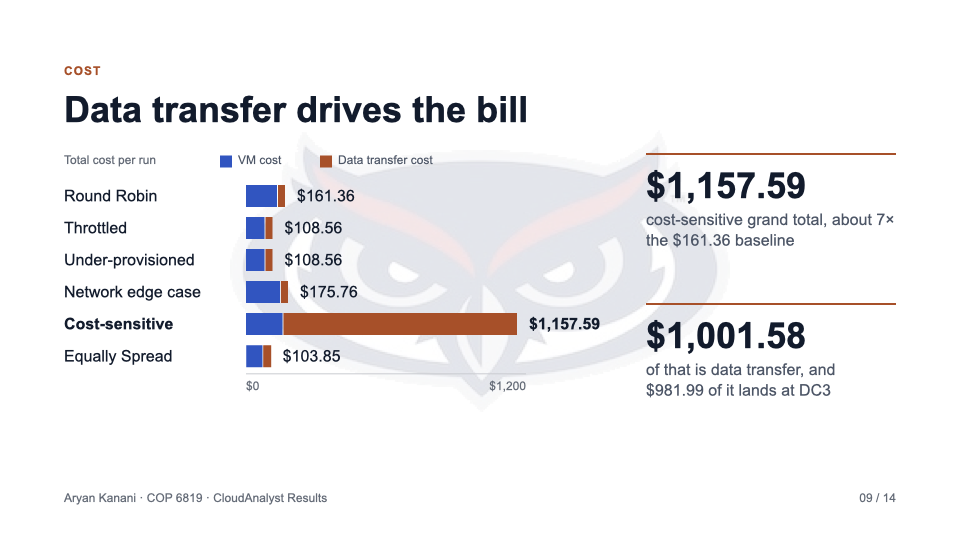
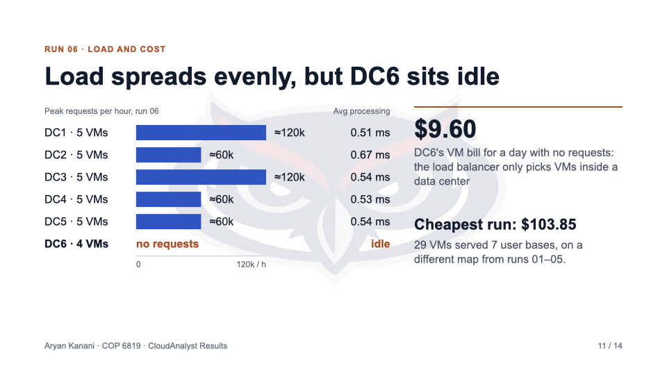

# CloudAnalyst: Load Balancing, Provisioning and Cloud Cost

A simulation study of how **load-balancing policy** and **data-center provisioning** affect **response time** and **cost** in a geographically distributed cloud application. I ran six CloudAnalyst simulations (CloudSim-based), changing one variable at a time, and analyzed the results for average latency, tail latency, processing time and cost.

**Read the work:** [Slide deck (PDF)](docs/CloudAnalyst-Slides.pdf) · [Full written report with simulation output (PDF)](docs/CloudAnalyst-Report.pdf)

*Course: COP 6819 Advanced Internet Systems, Florida Atlantic University*



## Key findings

1. **Network latency dominates the average.** The five runs on the shared topology all land at 92–95 ms regardless of policy, and data-center processing adds only a few milliseconds.
2. **Provisioning drives the tail, not the mean.** Starving data centers barely moves the average (95.44 ms), but the maximum response time jumps to **552.75 ms**, about 38% worse than the comparable run's 400.88 ms.
3. **Choose the policy by the binding constraint.** Round Robin is fastest (92.59 ms). Throttled is cheapest ($108.56), saving $52.80 for 2.84 ms more latency.
4. **Payload size is the biggest cost lever.** Making requests 100× larger pushed total cost to **$1,157.59**, about 7× the baseline, and $1,001.58 of that was data transfer.
5. **Load balancing works inside a data center, not across them.** Equally Spread kept processing flat at 0.55 ms, but an idle data center that received no traffic still billed $9.60.

**Takeaway:** report the tail (max / p95 latency), not just the average. In this study the average hid the worst failure mode.

## Setup

**Runs 01–05** share one base topology and each change a single variable (the service-broker policy, the VM count per data center, or the request size):

- 6 user bases (UB1–UB6) and 4 data centers (DC1–DC4)
- 1,000 peak users per user base, 60 requests per user per hour
- 100-byte requests at baseline

**Run 06** tests a load-based policy on a larger map: 7 user bases, 6 data centers and custom network latencies.

## Scenarios

| # | Scenario | VMs per DC | What it tests |
|---|---|---|---|
| 01 | Round Robin (baseline) | 15 / 5 / 5 / 30 | VMs take requests in turn |
| 02 | Throttled | 1 / 1 / 1 / 30 | Caps concurrent requests per VM when compute is scarce |
| 03 | Under-provisioned DC | 1 / 1 / 1 / 30 | Same layout, analyzed for worst-case tail latency |
| 04 | Network latency edge case | 20 / 1 / 20 / 20 | A single weak region (DC2) as a bottleneck |
| 05 | Cost-sensitive | 15 / 15 / 20 / 15 | UB3 and UB5 send 100× larger requests |
| 06 | Equally Spread Current Execution Load | 5 / 5 / 5 / 5 / 5 / 4 | Least-busy-VM policy on a larger 7-UB / 6-DC map |

## Results

| Scenario | Avg response (ms) | Max response (ms) | DC processing avg (ms) | Total cost |
|---|---:|---:|---:|---:|
| Round Robin | **92.59** | 400.88 | 0.84 | $161.36 |
| Throttled | 95.43 | 400.88 | 3.68 | **$108.56** |
| Under-provisioned DC | 95.44 | *552.75* | 3.68 | **$108.56** |
| Network latency edge case | 93.51 | 401.07 | 1.76 | $175.76 |
| Cost-sensitive | 95.20 | 550.67 | 0.84 | *$1,157.59* |
| Equally Spread (run 06) † | 78.81 | 258.31 | 0.55 | $103.85 |

**Bold** = best and *italic* = worst across runs 01–05. † Run 06 uses a different, larger map with shorter latencies, so it isn't ranked against runs 01–05.

## Highlights

| | |
|---|---|
|  |  |
|  |  |

## Repository contents

```
docs/
  CloudAnalyst-Slides.pdf    14-slide results presentation
  CloudAnalyst-Report.pdf    Full report: per-scenario setup, CloudAnalyst output, analysis
images/slides/               PNG export of every slide
source/                      Original PowerPoint (.pptx) and Pages (.pages) files
```

## Skills demonstrated

- Cloud simulation with **CloudAnalyst / CloudSim**: user bases, data centers, VM allocation and service-broker policies
- Comparing load-balancing algorithms: **Round Robin, Throttled, Equally Spread Current Execution Load**
- Performance analysis: average vs. tail latency, per-region response time, data-center processing time
- Cloud cost modeling: VM cost vs. data-transfer cost
- Experiment design that changes one variable at a time, and presenting the results as data visualizations
